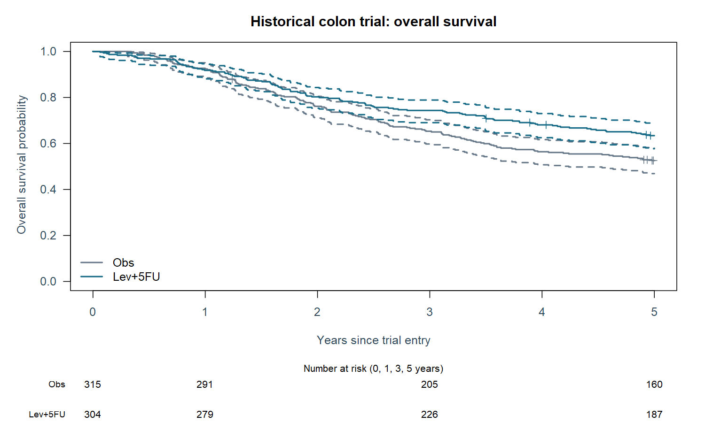
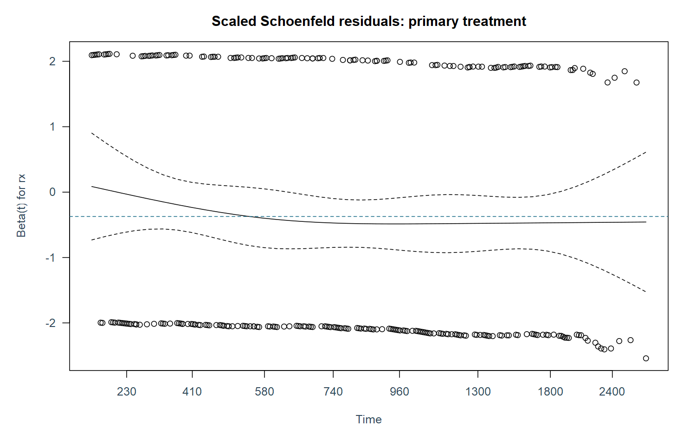

# 结肠癌历史试验：生存分析与统计报表

公开历史数据复核项目，非新开展的临床试验。比较原分配Lev+5FU与观察组；总体生存为主终点。数据、口径、代码和结果可追溯。

## 1. 分析集和质量控制

1858条记录对应929位患者，每人复发/死亡各一条。先筛选etype=2，再保留两组，共619人。Lev单药组不进入主要对比。数据包存在12例nodes与node4不一致，单列核查且不擅自更正。主分析不因基线缺失排除患者。

| stage | n |
| --- | --- |
| Endpoint records | 1858 |
| Unique patients / death records | 929 |
| Excluded Lev-only arm | 310 |
| Primary two-arm population | 619 |

## 2. 基线描述

连续变量均值(SD)，分类百分比分母为本治疗组全部受试者，缺失单列；不对随机化基线做显著性筛选。

| variable | level | Obs | Lev+5FU |
| --- | --- | --- | --- |
| age | mean (SD); observed n; missing n | 59.45 (11.97); n=315; missing=0 | 59.70 (12.26); n=304; missing=0 |
| nodes | mean (SD); observed n; missing n | 3.79 (3.73); n=312; missing=3 | 3.49 (3.42); n=295; missing=9 |
| sex | 0 | 149 (47.3%) | 163 (53.6%) |
| sex | 1 | 166 (52.7%) | 141 (46.4%) |
| sex | Missing | 0 (0.0%) | 0 (0.0%) |
| extent | 1 | 8 (2.5%) | 10 (3.3%) |
| extent | 2 | 38 (12.1%) | 32 (10.5%) |
| extent | 3 | 249 (79.0%) | 251 (82.6%) |
| extent | 4 | 20 (6.3%) | 11 (3.6%) |
| extent | Missing | 0 (0.0%) | 0 (0.0%) |
| surg | 0 | 224 (71.1%) | 228 (75.0%) |
| surg | 1 | 91 (28.9%) | 76 (25.0%) |
| surg | Missing | 0 (0.0%) | 0 (0.0%) |

## 3. Kaplan-Meier与风险集

删失表示观察结束时未见死亡，不能编码为终生存活。依赖独立删失假设；这里没有脱落原因和详细治疗依从资料。5年截断图不等于丢弃更长期数据。

| arm | day | at_risk | survival | ci_low | ci_high |
| --- | --- | --- | --- | --- | --- |
| rx=Obs | 0.00 | 315 | 1.00000 | 1.00000 | 1.00000 |
| rx=Obs | 365.25 | 291 | 0.92381 | 0.88848 | 0.94827 |
| rx=Obs | 1095.75 | 205 | 0.65315 | 0.59771 | 0.70291 |
| rx=Obs | 1826.25 | 160 | 0.52567 | 0.46897 | 0.57918 |
| rx=Lev+5FU | 0.00 | 304 | 1.00000 | 1.00000 | 1.00000 |
| rx=Lev+5FU | 365.25 | 279 | 0.91776 | 0.88072 | 0.94367 |
| rx=Lev+5FU | 1095.75 | 226 | 0.74342 | 0.69041 | 0.78876 |
| rx=Lev+5FU | 1826.25 | 187 | 0.63401 | 0.57707 | 0.68545 |

## 4. 治疗对比与敏感性

主分析log-rank p=0.0015949。Cox HR为瞬时风险之比，不是5年死亡风险之比。调整模型加入年龄、性别、nodes与分期，因缺失排除12人，仅作敏感性。主模型PH全局p=0.2758；结合残差图解释，未拒绝PH不等于证明PH成立。

| model | n | events | HR | ci_low | ci_high | p |
| --- | --- | --- | --- | --- | --- | --- |
| Primary unadjusted | 619 | 291 | 0.68880 | 0.54573 | 0.86937 | 0.00169864 |
| Sensitivity complete-case adjusted | 607 | 285 | 0.65746 | 0.51843 | 0.83377 | 0.00054074 |

## 5. 限制平均生存时间

预设tau=5年，计算KM曲线下面积；按治疗组内重抽患者1000次得到百分位95%区间。RMST差以天计，可在PH不理想时提供另一种描述；与HR是不同目标量，不按显著性择优报告。

| tau_days | control_days | treatment_days | difference_days | ci_low_days | ci_high_days | bootstrap_replicates |
| --- | --- | --- | --- | --- | --- | --- |
| 1826.2 | 1339.2 | 1450.7 | 111.47 | 17.373 | 200.67 | 1000 |

## 6. 研究边界

这是对公开分析记录的回顾性再分析，无法重新确认全体原始随机化名单、治疗中断和追踪细节，不能声称完整监管级ITT或安全性评价。无AE信息，不生成虚构安全性表。公开历史方案不支持当代临床用药决策。该项目不宣称CDISC/ADaM合规。数据来源及字段见docs/DATA.md；冻结方案见ANALYSIS_PLAN.md。
